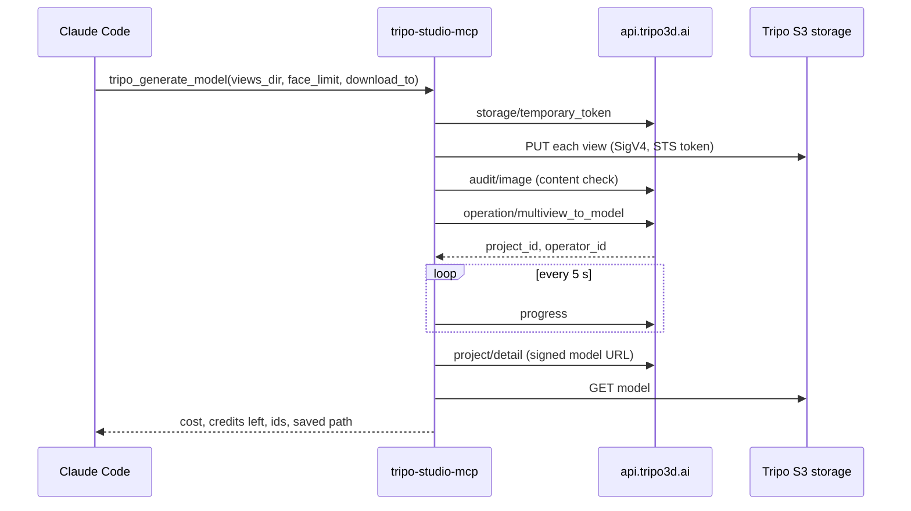

<div align="center">

# Tripo Studio MCP

**Run Tripo Studio from Claude Code and pay with your Studio subscription credits.**

One small Go binary. Every paid job takes one call, and results are saved where you say.

[](https://go.dev)
[](https://modelcontextprotocol.io)
[](https://claude.com/claude-code)
[](LICENSE)

English · [Русский](README.ru.md)

</div>

> [!WARNING]
> This project is unofficial and not affiliated with Tripo or VAST. It uses the internal web API behind studio.tripo3d.ai, which can change without notice, and automated use may conflict with Tripo's terms of service. Use it at your own risk.

## Why

Tripo has two separate credit wallets. Studio credits come with the web subscription (Pro, Max, …). API credits are sold separately for developers. The official API, `tripo-cli` and the existing MCP servers can only spend API credits, so subscription credits are usable only by clicking through the website.

This server sends the same requests the Studio website sends, signed in with your browser session. Claude can then generate, texture, retopologize and download models while charging your subscription.

It is a rewrite of the unofficial [tripo-studio-plugin](https://github.com/GrinZero/tripo-studio-plugin) (Node, MIT), rebuilt to work well inside Claude Code:

| | tripo-studio-plugin 0.3.12 | **tripo-studio-mcp** |
|---|---|---|
| Runtime | Node 20+ and about 24 MB of bundles | **one 7 MB binary, no dependencies** |
| Paid job | staged, then a 60-second review card, then auto-submit | **one call submits and reports the cost and credits left** |
| In Claude Code | review and preview cards fail with `IPC not available (-32603)` | **plain, readable results** (the inline widget is in progress) |
| Sign-in on Windows | reading browser cookies fails (app-bound encryption) | **import the cookie once** (from a file, a value or the old plugin) |
| Price quotes | reviewed pricing contract expired, so quotes say *unknown* | **dated price table** that can be overridden without rebuilding |
| Wait, then download | separate calls | **`download_to` on any paid tool** |
| Multiview inputs | four explicit paths | **`views_dir`**: picks up `*front*`, `*left*`, `*back*` and `*right*` |

## Quick start

**1. Get the binary.** Download it from [Releases](../../releases), or build it:

```bash
go build -o tripo-studio-mcp.exe .
```

**2. Add it to Claude Code.** This registers it for the current project; add `-s user` for every project.

```bash
claude mcp add tripo-studio -- C:/Tools/tripo-studio-mcp.exe
```

**3. Sign in once.** In Chrome or Edge, signed in at [studio.tripo3d.ai](https://studio.tripo3d.ai): open DevTools, then Application, then Cookies, and copy the value of `ory_kratos_session` into a text file. Then ask Claude:

> Import my Tripo session from `C:/Users/me/tripo-cookie.txt`

The cookie is checked against Tripo, stored in `%LOCALAPPDATA%\TripoStudioMCP\session.json` and never shown. It lasts about 30 days. Delete the text file afterwards.

**4. Make something.**

> Make a Smart Mesh P1 from the views in `./parts/arm/inputs`, 19,500 faces, save it to `./parts/arm/mesh.glb`, then texture it at 2K from the same views and save `textured.glb`.

## Tools

| Tool | Credits | What it does |
|---|---:|---|
| `tripo_generate_model` | **35** P1 · **100** P2 · 15+ H3.1 | Model from one image or multiview (front plus left, back or right) |
| `tripo_texture` | **10** 2K · **20** 4K · **30** 8K | Texture an existing model, keeping its geometry |
| `tripo_remesh` | **5 / 10** plain · **35 / 40** Smart Poly | Retopology (triangles / quads) |
| `tripo_segment` | **40** | Split a model into semantic parts |
| `tripo_wait` | free | Check or wait for a job; optionally download the result |
| `tripo_download` | free | Save the stored model, an earlier version, or a glb/fbx/obj export |
| `tripo_list_projects`, `tripo_project` | free | Browse your models; flags such as textured, quad, Smart Mesh, rigged |
| `tripo_balance` | free | Credits, plan, free quotas |
| `tripo_auth_import`, `tripo_auth_status` | free | Store and check the session |
| `tripo_upload_image` | free | Upload an image and run Tripo's content check |

Every paid tool accepts:

- **`dry_run: true`** checks the inputs and returns the price and your balance; nothing is uploaded or charged.
- **`download_to: "path"`** waits for the job and saves the model, in the same call.

Defaults are the cheapest sensible options: Smart Mesh **P1**, triangles, **private**, 2K texture, standard geometry, no PBR.

### What a call returns

```text
Submitted: Smart Mesh P1.0, 19,500 faces (triangles), private, from multiview (front 0_front.png, left 1_left.png, back 2_back.png, right 3_right.png)
Cost: 35 credits (GenerateBaseNexus 35; prices of 2026-10-25). Credits left: 25,045.
project_id: 5f0c2a9e-1b7d-4c3e-9a61-2d8e4b7f0c13
operator_id: 9b4e7d21-6c0a-4f58-b3e2-7a1d9c5f8e04
Done. Project 5f0c2a9e-… "arm": textured no, PBR no, quad no, Smart Mesh yes, segmented no, rigged no; model file: ready.
Saved the stored model to D:\parts\arm\mesh.glb, 91 KB.
```

## How it works



## Safety with paid calls

- Paid tools submit as soon as they are called. The server tells Claude to get your OK with the price first, and `dry_run` gives that price.
- If Tripo refuses a request (for example, code 2010, not enough credits), the error says *not submitted, nothing charged*.
- If the network fails after a request was sent, the result is reported as *outcome unknown*. Paid requests are **never retried automatically**. Check `tripo_list_projects` before trying again.
- Arguments are strict: a misspelt option is an error, not a setting that is silently ignored.

## Prices

Prices live in [`prices.json`](prices.json), keyed by Studio's own price keys and dated. To change one without rebuilding, write an override to `%LOCALAPPDATA%\TripoStudioMCP\prices.json`:

```json
{ "updated": "2026-11-01", "credits": { "GenerateBaseNexus": 40 } }
```

The file is read on every call.

## Roadmap

- [ ] **Full port** of the plugin's 68 tools: image generation and multiview, text and batch inputs, P2 variants, model import, PBR, texture upscale and Magic Brush, Smart UV, part completion, rigging, animation and motion, local Blender editing, asset groups, task history.
- [ ] **Inline result widget** for Claude: 3D preview, input thumbnails, cost and progress. It gets everything it needs in the tool result, so it does not rely on host tool-call IPC, which is where the original's cards break.
- [ ] Release builds for Windows, macOS and Linux.

## Development

```bash
go vet ./... && go test ./...
```

| File | What is in it |
|---|---|
| `main.go` | MCP stdio JSON-RPC loop |
| `tools.go` | tool schemas, argument checks, results text |
| `tripo.go` | Studio API client, session, S3 upload (SigV4), jobs, downloads, prices |

Set `TRIPO_MCP_DATA_DIR` to keep the session and price override somewhere other than `%LOCALAPPDATA%\TripoStudioMCP`.

## Credits

The request shapes and Studio contract come from [GrinZero/tripo-studio-plugin](https://github.com/GrinZero/tripo-studio-plugin) (MIT), whose authors mapped the Studio API first. Thank you.

MIT © 2026 limeflash. See [LICENSE](LICENSE).
