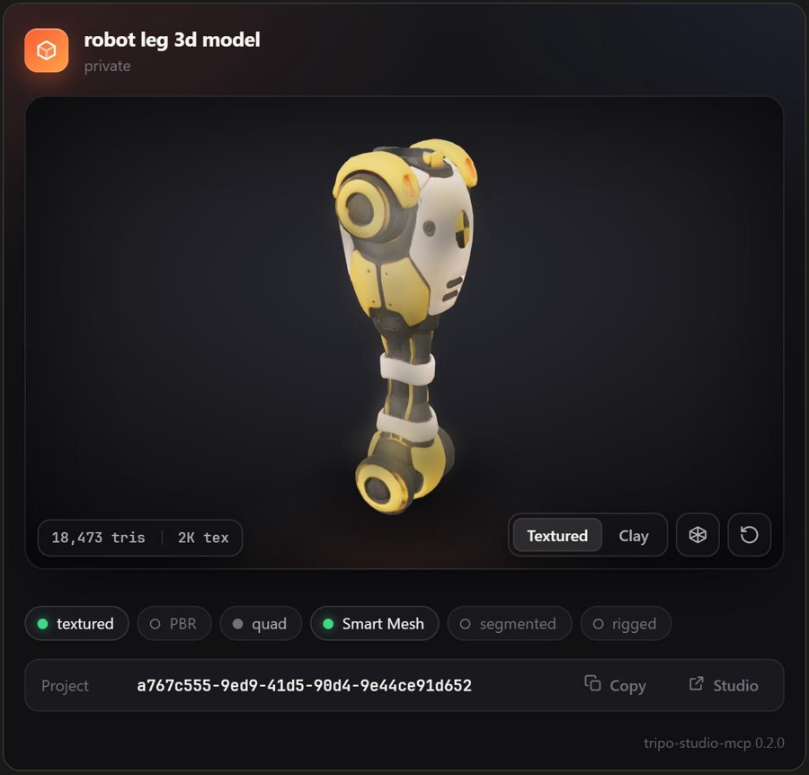
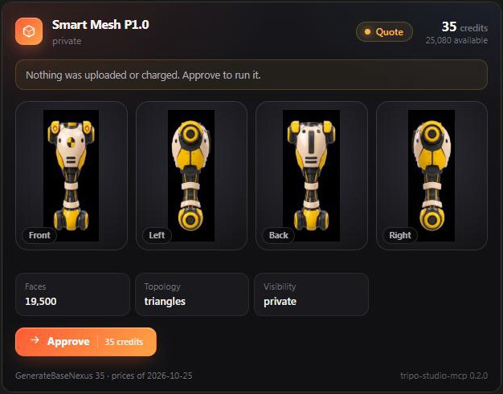
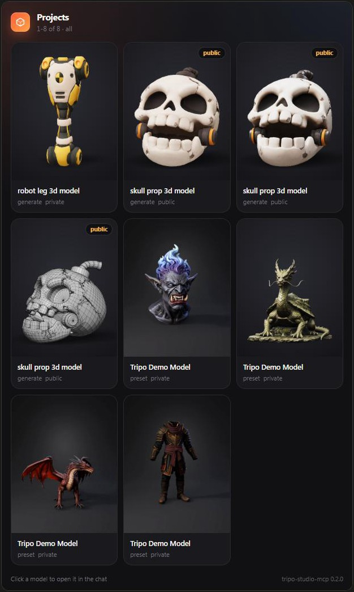

<div align="center">

# Tripo Studio MCP

**Tripo Studio прямо в Claude Code, за кредиты подписки Studio, с живыми 3D-карточками результатов в чате.**

Один бинарник на Go и 54 инструмента. Любая задача запускается одним вызовом, результат сохраняется туда, куда скажешь.

[](https://go.dev)
[](https://modelcontextprotocol.io)
[](https://claude.com/claude-code)
[](LICENSE)

[English](README.md) · Русский



</div>

> [!WARNING]
> Неофициальный проект, не связан с Tripo или VAST. Он использует внутренний веб-API сайта studio.tripo3d.ai, который может измениться без предупреждения, а автоматизация может противоречить условиям использования Tripo. Используй на свой риск.

## Зачем

У Tripo два отдельных кошелька. Кредиты Studio идут с веб-подпиской (Pro, Max и т.д.), а кредиты API продаются разработчикам отдельно. Официальный API, `tripo-cli` и существующие MCP-серверы тратят только кредиты API, поэтому кредиты подписки до сих пор можно было тратить только руками на сайте.

Этот сервер отправляет те же запросы, что и сайт Studio, от имени твоей сессии в браузере. Claude генерирует, текстурирует, режет на части, делает ретопологию, риг и скачивает модели за кредиты подписки.

Это полная переделка неофициального [tripo-studio-plugin](https://github.com/GrinZero/tripo-studio-plugin) (Node, MIT):

| | tripo-studio-plugin 0.3.12 | **tripo-studio-mcp** |
|---|---|---|
| Запуск | Node 20+, около 24 МБ бандлов и WASM на 15 МБ | **один бинарник на 12 МБ** |
| Платная задача | подготовка → 60-секундная карточка подтверждения → автоотправка | **один вызов: отправка, цена, остаток кредитов** |
| Карточки в Claude Code | падают с `IPC not available (-32603)`, 3D-превью недоступно | **работают: всё приходит в результате вызова** |
| 3D-превью | нужен WebAssembly в виджете или обратный вызов сервера | **meshopt распаковывается на Go, без WASM и без сети** |
| Вход на Windows | чтение cookie браузера ломается (app-bound encryption) | **cookie импортируется один раз** (файл, значение или сессия старого плагина) |
| Цены | проверенный прайс устарел, оценки *unknown* | **датированная таблица цен, правится без пересборки** |
| Дождаться и скачать | отдельные вызовы | **`download_to` в любом платном инструменте** |
| Виды для multiview | четыре пути вручную | **`views_dir`** сам находит `*front*`, `*left*`, `*back*`, `*right*` |
| Локальные инструменты Blender | писались под Blender 3.x/4.x | **обновлены под Blender 5.x** (исправлен проекционный бейк; на старых версиях не проверено) |

## Карточки

Каждый визуальный результат выводится в чат карточкой MCP App. Тема тёмная, чтобы модели смотрелись выигрышно. В карточке:
- 3D-просмотр: вращение, Ctrl + колесо для зума, режимы Textured / Clay / Parts, сетка.
- Входные виды, настройки, цена и остаток кредитов.
- Пути к сохранённым файлам и ID с кнопкой копирования, ссылка в Studio.
- Кнопки следующего шага («Texture 2K · 10 credits»): отправляют запрос в чат, а если хост этого не разрешает, копируют его.

<table>
<tr>
<td width="50%"></td>
<td width="50%"></td>
</tr>
<tr>
<td align="center"><sub><code>dry_run</code>: цена до любых трат</sub></td>
<td align="center"><sub><code>tripo_list_projects</code>: твоя библиотека</sub></td>
</tr>
</table>

Карточка никогда не обращается к серверу сама, потому что Claude Code не пропускает такие вызовы. Всё нужное лежит в результате вызова инструмента:
- данные карточки — в `structuredContent`;
- миниатюры, обложки и сама модель — в `_meta`. Модель передаётся как GLB с распакованным meshopt и текстурами, ужатыми до 1024 px, это около 1 МБ.

## Быстрый старт

**1. Бинарник.** Скачай со страницы [Releases](../../releases) или собери:

```bash
go build -o tripo-studio-mcp.exe .
```

**2. Подключи к Claude Code.** С `-s user` он будет во всех проектах.

```bash
claude mcp add tripo-studio -- C:/Tools/tripo-studio-mcp.exe
```

**3. Войди один раз.** Открой [studio.tripo3d.ai](https://studio.tripo3d.ai) в Chrome или Edge, где ты залогинен. В DevTools → Application → Cookies скопируй значение `ory_kratos_session` в текстовый файл и попроси Claude:

> Импортируй сессию Tripo из `C:/Users/me/tripo-cookie.txt`

Cookie проверяется на сервере Tripo, сохраняется в `%LOCALAPPDATA%\TripoStudioMCP\session.json` и нигде не выводится. Сессия живёт около 30 дней. Файл с cookie после этого удали.

**4. Сделай что-нибудь.**

> Сделай Smart Mesh P1 по видам из `./parts/arm/inputs`, 19 500 полигонов, сохрани в `./parts/arm/mesh.glb`, потом затекстурь в 2K по тем же видам и сохрани `textured.glb`.

## Инструменты

Цены в кредитах — это прайс самого Studio на 25.10.2026. Любой платный инструмент принимает:
- `dry_run: true` — показать цену и баланс, ничего не тратя;
- `download_to` — дождаться задачи и сохранить результат.

**Модели:**
- `tripo_generate_model`: **35** P1 · **100** P2 · от 15 H3.1. Источник: картинка, multiview, текст, пакет до 30 картинок или картинки Studio. Варианты P2 (1, 2 или 4), квады, симметрия, опции High Detail.
- `tripo_texture`: **10** 2K · **20** 4K · **30** 8K, +5 за стиль. Источник: картинка, multiview или текст. Стили, вся модель или отдельные `part_names`. После задачи проверяется, что разрешение текстуры соответствует заказанному.
- `tripo_generate_pbr` **5** · `tripo_upscale_texture` **10/20**.
- `tripo_remesh`: **5/10** обычный · **35/40** Smart Poly.

**Части.** Разбиение на части у Tripo сделано полноценным сценарием:
- `tripo_segment` **40**: разбить на смысловые части.
- `tripo_list_parts` бесплатно: имена частей и число полигонов в каждой.
- `tripo_complete_parts` **0**: AI-достройка или quick cap открытых частей.
- Текстура и ремеш принимают `part_names`.

**Картинки:**
- `tripo_generate_image`: цена зависит от модели, скидка тарифа и бесплатный лимит учитываются.
- `tripo_generate_multiview` ?: четыре вида из одной картинки, их можно сразу отдать в `tripo_generate_model`.
- `tripo_regenerate_image` ?, `tripo_split_image` ?.
- `tripo_upscale_image` **10**.
- Списки ассетов и шаблонов бесплатно.

**Риг, анимация, UV, экспорт:**
- `tripo_rig_model` **20**: сначала бесплатная проверка, пригодна ли модель для рига.
- `tripo_animate_model` ? и `tripo_apply_motion` ?: готовые анимации или сгенерированное движение.
- `tripo_generate_motion` **20**.
- Smart UV **20**, сначала тратится бесплатный лимит.
- `tripo_export_model` 0: glb, fbx, obj, usdz, stl или 3mf со всеми настройками Studio.

**Локально и бесплатно** (Blender берётся из `TRIPO_BLENDER_EXECUTABLE` или `blender` в PATH): `tripo_inspect_local_parts` · `tripo_render_model` · `tripo_edit_parts` · `tripo_bake_texture_projection` · `tripo_paint_texture` · `tripo_crop_image`.

**Библиотека и аккаунт:**
- Проекты: `tripo_list_projects` · `tripo_project` · `tripo_wait` · `tripo_download` · `tripo_import_model` · `tripo_open_in_studio`.
- Баланс и задачи: `tripo_balance` · `tripo_list_prices` · `tripo_list_jobs` · `tripo_get_job`.
- Группы ассетов и сервис: группы ассетов · `tripo_upload_image` · вход и выход.

*?* значит, что в прайсе Studio нет такой цены. Оценка покажет *unknown*, и сервер велит Claude сначала спросить тебя.

## Безопасность платных вызовов

- Платный инструмент отправляет задачу сразу. Сервер просит Claude сначала получить твоё согласие на цену, а `dry_run` эту цену показывает.
- Если Tripo отказал (например, код 2010 — не хватает кредитов), ошибка начинается с *not submitted, nothing charged*: ничего не списано.
- Если сеть оборвалась после отправки, это *outcome unknown*. Платные запросы **никогда не повторяются автоматически**: сначала проверь `tripo_list_projects`.
- Аргументы проверяются строго: опечатка в параметре даёт ошибку, а не молча игнорируется.
- Каждая платная задача записывается в `jobs.jsonl`, посмотреть журнал можно через `tripo_list_jobs`.

## Цены

Цены лежат в [`prices.json`](prices.json): по ключам цен самого Studio, с датой проверки. Чтобы поменять цену без пересборки, положи переопределение в `%LOCALAPPDATA%\TripoStudioMCP\prices.json`:

```json
{ "updated": "2026-11-01", "credits": { "GenerateBaseNexus": 40 } }
```

Файл перечитывается при каждом вызове.

## Благодарности

- Формы запросов и контракт Studio взяты из [GrinZero/tripo-studio-plugin](https://github.com/GrinZero/tripo-studio-plugin) (MIT), включая его Blender-воркер.
- Распаковщик meshopt — порт [meshoptimizer](https://github.com/zeux/meshoptimizer) (MIT).
- Карточка сделана на [three.js](https://threejs.org) и [MCP Apps SDK](https://github.com/modelcontextprotocol/ext-apps).

MIT © 2026 limeflash. См. [LICENSE](LICENSE).
